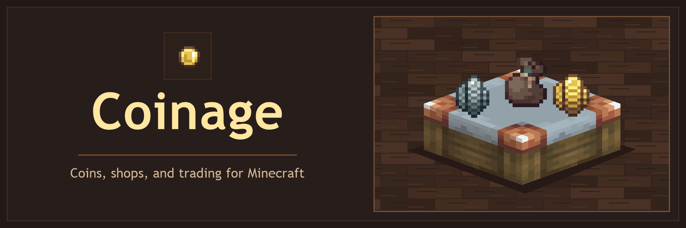

# Coinage



Coinage adds physical coins, a personal purse, piggy banks, player shops, pawn shops, and currency trades for villagers and wandering traders.

By pokesmells and Bare Minimum Studios.

- Earn four tiers of physical coins from eligible mobs, loot, and trading.
- Carry coins in a personal purse, bundle them into money bags, or store them in piggy banks.
- Buy and sell through player shops, pawn shops, and configurable merchant offers.
- Enable shared supply-and-demand pricing and optional Easy NPC integration on your server.

## Install

Pick the Coinage JAR for your exact Minecraft version and loader. Install Coinage and its dependencies on the server and on each modded client.

| Minecraft | Java | Fabric dependencies | NeoForge dependencies |
| --- | --- | --- | --- |
| 1.21.1 | 21 | Fabric API, Fabric Language Kotlin, Fzzy Config | Kotlin for Forge, Fzzy Config |
| 26.3 | 25 | Fabric API, Fabric Language Kotlin, Fzzy Config | Kotlin for Forge, Fzzy Config |

The [target files](targets/) record the versions used to build and test each release. Crunch is bundled inside the Coinage JAR.

## Use the purse

Press **B**, click the purse icon in your inventory, or run `/coinage purse`. Use the arrows to adjust the number of coins for each denomination. Hold **Shift** to adjust by ten. The extraction button withdraws the selected coins, and **Ctrl**-clicking it puts the selected value into one money bag. **Shift**-click the purse icon to deposit all currency from your inventory. Hold **Shift + Ctrl** while clicking the extraction button to withdraw the full balance as coins if they fit.

Coins stack to 100. The default rates are 100 bronze to 1 silver, 100 silver to 1 gold, and 100 gold to 1 platinum. Servers can change the three ratios in Fzzy Config. Enter plain amounts in bronze or use expressions such as `2 * silver + 5 * bronze`. Press Tab in a command to complete a coin name and see its value in bronze.

| Command | Use |
| --- | --- |
| `/coinage balance` | Check your purse balance. |
| `/coinage rates` | Show the server's exchange rates. |
| `/coinage deposit` | Deposit currency from your inventory. |
| `/coinage withdraw <amount>` | Withdraw physical coins. |
| `/coinage bag <amount>` | Put an amount into a money bag. |
| `/coinage pay <player> <amount>` | Transfer purse funds when player payments are enabled. |
| `/coinage balance <players> [get\|set\|add\|subtract]` | Inspect or update selected players' balances. Requires operator permission. Include an amount with set, add, or subtract. |
| `/coinage serverworth` | Total all player purse balances, including offline players. Requires operator permission. |
| `/coinage top [limit]` | Rank purse balances. Requires operator permission. |

## Piggy banks

Piggy banks hold physical coins and money bags in 27 slots. Open a bank and click the hopper button to quick-stack currency from your inventory.

## Purse funds on death

The server's `deathLossPercent` sets how much of the purse becomes a money bag on death. With a compatible version of You're in Grave Danger or GraveStone Mod, the grave captures that bag along with the other death drops. With `keepInventory` enabled, the purse keeps its balance.

## Automatic coin collection

Run `/coinage autocollect toggle` to change your preference, or use `/coinage autocollect true` or `false` to set it directly. Run `/coinage autocollect` to check the current setting. It starts off and saves separately for each player in each world. When enabled, picking up dropped coins puts them in your purse. Money bags and coins with custom item data still go into your inventory.

## Shops and server settings

Stock a shop with goods to sell. Fund a pawn shop to buy goods from players. Use **Edit Offers** in a shop you manage to set templates and prices. The automation toggle controls whether item transfer systems may access the shop's stock. It starts disabled.

Server settings use Fzzy Config under `config/coinage/`. Client settings include purse button visibility, HUD position, and balance notifications. Open **Purse button position** in Coinage's client settings to move the button in inventory, Creative, merchant, and pawn shop screens.

Use the same Coinage version on clients and servers.

## NPC shops and shared prices

Place and configure a shop or pawn shop. Use an inexhaustible variant for a server-run shop with unlimited stock or purchasing funds. Add its location to the server's Fzzy Config, `config/coinage/economy.toml`.

```toml
[market]
enabled = true
pricePercent = "100 + pressure + spillover"
resetIntervalSeconds = 7200
remoteShops = { town_goods = "minecraft:overworld 20 64 8", town_buyer = "minecraft:overworld 22 64 8" }
```

Add an **Execute as player** command action in Easy NPC with `coinage shop open town_goods`. If your Easy NPC version uses a command allowlist, add `coinage` as a normal player command. The player can also run this command directly. List only public locations and keep their chunks loaded, for example with `/forceload add 20 8` in the shop's dimension. Remote menus allow trades and leave management at the physical shop. See [Easy NPC command actions](https://github.com/MarkusBordihn/BOs-Easy-NPC/wiki/Actions).

Market pricing is opt-in. All Coinage shop and pawn-shop trades share a market per world, keyed by the traded item ID. Purchases raise its pressure and sales lower it. Oversupply of other goods adds a small positive spillover. The default Crunch expression uses `pressure` from −50 to 50 and `spillover` from 0 to 10. The result is clamped to 50–150 percent of each offer's base price. Use separate retail and buyback base prices to prevent profitable round trips.

The market persists across restarts and resets to base prices every two hours of world time by default (144,000 ticks). Set `resetIntervalSeconds` under `[market]` to change the interval. The current reset deadline is kept, and the new setting takes effect when the following deadline is scheduled.

To use the built-in Easy NPC trading screen instead, set up an NPC trade with one item on each side and a plain Coinage coin stack or money bag on one side. With market pricing enabled, those trades use the same world market as Coinage shops. The NPC editor keeps the configured base price. Emerald trades, two-input trades, and vanilla villagers keep their existing pricing.

## Merchant datapacks

In `config/coinage/economy.toml`, use the `[merchantTrades]` section to choose how Coinage handles newly generated offers.

| Mode | Newly generated offers |
| --- | --- |
| `REPLACE` | Use Coinage profiles for the professions they cover. |
| `APPEND` | Keep native offers and add Coinage offers. Set `convertEmeralds = false` to keep native emerald prices and payouts. |
| `DISABLED` | Leave offer generation and emerald prices to Minecraft and other mods. |

Use `excludedProfessions` to keep individual professions out of Coinage's trade generation and emerald conversion without changing the mode for other merchants. Existing villagers keep their saved offers when a profile is reloaded.

Both Minecraft targets read Coinage profiles from `data/<namespace>/villager_trades/`. For example, put this file at `data/example/villager_trades/librarian.json` to offer a water potion for 205 bronze at the default exchange rates.

```json
{
  "profession": "minecraft:librarian",
  "replace": true,
  "trades": {
    "novice": [
      {
        "type": "coinage:sell_stack",
        "price": "2 * silver + 5",
        "sell": {
          "id": "minecraft:potion",
          "components": {
            "minecraft:potion_contents": { "potion": "minecraft:water" }
          }
        }
      }
    ]
  }
}
```

Use `"replace": true` to replace the profession's entire Coinage profile. Omit it to add offers to the existing profile. Run `/reload` after editing a datapack and `/coinage trades status` to check the loaded and rejected definitions.

On **26.3**, you can also use Minecraft's native `villager_trade` and `villager_trade_set` registries. Pick `APPEND` to use native trades alongside Coinage profiles, or `DISABLED` to let the native registries control offer generation entirely. Use Coinage profiles on either version for prices such as `2 * silver + 5`, which follow the server's configured exchange rates.

## Mob currency drops

Edit the `[mobDrops]` table in the server's `config/coinage/economy.toml`. Entries set the base value in bronze coins for kills credited to a player. The default rule pays 75 bronze for entities in `#coinage:currency_drops`. Datapacks can extend that tag through `data/coinage/tags/entity_type/currency_drops.json`.

```toml
[mobDrops]
"minecraft:pillager" = 75
"#example:currency_drops" = 40
```

To use the tag in this example, add `data/example/tags/entity_type/currency_drops.json` to a datapack.

```json
{
  "values": ["minecraft:zombie", "minecraft:skeleton"]
}
```

An exact entity ID takes precedence over a tag, a tag takes precedence over a namespace such as `@example`, and a namespace takes precedence over a mob category such as `€monster`. Add an exact entry with value `0` to exclude one mob. Reload datapacks after editing tags. The economy settings also control random variation, health scaling, and the Looting bonus.

## Money bags in loot tables

Put a `coinage:money_bag` in a loot entry and apply `coinage:set_money` to give it a value in bronze. Coinage preserves other custom item data.

For **1.21.1**, add `{"function":"coinage:set_money","value":250}` to the loot entry's `functions` list. The `value` also accepts a vanilla number provider.

For **26.3**, you can share one reward across multiple tables. Put the number `250` in `data/example/context_int_provider/chest_reward.json`, then create `data/example/item_modifier/money_bag_reward.json`.

```json
{
  "type": "coinage:set_money",
  "value": "example:chest_reward"
}
```

Set the money bag loot entry's `"modifier"` to `"example:money_bag_reward"`, or include that reference in its list of modifiers. Change the provider file and reload the datapack to update every table that uses it.

## Build locally

- Windows · `./scripts/build.ps1 -Loader both -Target all`
- Linux · `bash scripts/build.sh both all`

The scripts build each selected target and verify the release JARs in `build/<version>/<loader>/libs/`. Artifact verification requires Python 3.11 or newer.

Coinage uses the [Bare Minimum License](LICENSE). See [NOTICE.md](NOTICE.md) and [LICENSE-UPSTREAM](LICENSE-UPSTREAM) for upstream attribution.
