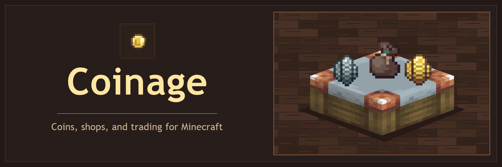

  
  
  
  
  

**Minecraft 1.21.1 and 26.3 · Fabric and NeoForge · Client and server**

[Documentation](https://github.com/BareMinimumStudios/coinage#readme) · [Source code](https://github.com/BareMinimumStudios/coinage) · [Discord](https://discord.gg/pcRw79hwey) · [Ko-fi](https://ko-fi.com/pokesmells)

Coinage gives your world a physical currency and places to spend it. Pick up coins from loot or eligible mobs, carry them in your purse, and trade with merchants or other players.

## Coins and purses

- **Bronze, silver, gold, and platinum.** Each coin tier stacks to 100. By default, 100 coins equal one coin of the next tier. Servers can adjust those rates.
- **A purse for every player.** Press **B**, use the inventory button, or run `/coinage purse`. Withdraw coins, bundle money into bags, or use `/coinage pay` when player payments are enabled.
- **Optional automatic collection.** Run `/coinage autocollect toggle` to send picked-up coins directly to your purse.
- **Piggy banks and money bags.** Store spare change or carry a fixed amount in a bag. If the server drops purse money on death, compatible versions of You're in Grave Danger and GraveStone Mod can capture the dropped bag.

## Shops and trading

- **Player shops and pawn shops.** Sell goods from your stock or buy them from other players with funds you supply. Server operators can also set up shops with unlimited stock or funds.
- **Villagers and wandering traders.** Configure merchant offers and pay for eligible trades directly from your purse.
- **Shared supply and demand.** When enabled, purchases and sales affect prices across participating shops. Prices return to their base values on a configurable timer, which defaults to two hours of game time at 20 TPS.
- **Easy NPC integration.** Open a named Coinage shop from an NPC command or use shared market prices for eligible trades in Easy NPC’s trading screen.

Server owners can configure the economy through Fzzy Config and use datapacks to customize merchant offers and coin drops.

## Installation

Install the matching Coinage build and its dependencies on the server and each modded client. Use **Java 21** for Minecraft **1.21.1** or **Java 25** for **26.3**.

- **Fabric:** Fabric API, Fabric Language Kotlin, and Fzzy Config.
- **NeoForge:** Kotlin for Forge and Fzzy Config.

## Credits

Created by pokesmells and Bare Minimum Studios under the [Bare Minimum License v1.1](https://github.com/BareMinimumStudios/coinage/blob/main/LICENSE). See the [upstream attribution](https://github.com/BareMinimumStudios/coinage/blob/main/NOTICE.md) for material adapted from Numismatic Overhaul.

## Sponsor

Use code **`bareminimum`** to get **25% off your first month**!
